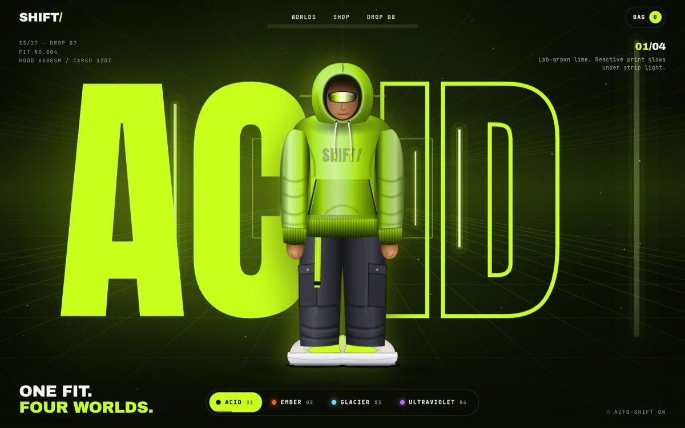

# SHIFT/ — One fit. Four worlds.

[](https://tabishhassan5121472.github.io/shift-four-worlds/)


A loud, Gen-Z streetwear landing page for a made-up label: one outfit dropped into four worlds (Acid, Ember, Glacier, Ultraviolet) that each restyle the whole page.

**Live demo:** [https://tabishhassan5121472.github.io/shift-four-worlds/](https://tabishhassan5121472.github.io/shift-four-worlds/)

## Techniques
- **Four canvas 2D scenes** that crossfade: a neon lab tunnel with flickering light strips (Acid), rising embers with a heat shimmer made from canvas slice displacement (Ember), twisting silk ribbons (Glacier), and a laser grid in perspective with sweeping beams (Ultraviolet).
- **Palette as CSS variables** tweened by GSAP. The hoodie's SVG gradients use `color-mix()` stops, so its colour morphs along with the page.
- **Hand-built SVG figure**: hoodie, cargo pants and chunky sneakers with layered gradients, blurred fold shadows, rib patterns and a rim light in the world colour.
- **Headline scramble**: the world name is split around the figure, scrambles into the new name and resizes to fit its column.
- Squash-and-stretch **jump**, a diagonal **wipe**, and **auto-cycling** with progress bars that stops once the user picks a world.
- Infinite **marquee** strips, plus **product cards** drawn in SVG whose colour swatches recolour the product. Cards lift on hover and have a quick-add button wired to a bag counter and a toast.
- **Flip-clock countdown** (pure CSS 3D flips) to the next Friday at 19:00.
- `?world=acid|ember|glacier|uv` deep-links to a world. Handles `prefers-reduced-motion`, pauses the canvas when offscreen, caps DPR at 2.

Stack: HTML, CSS, vanilla JS, GSAP 3.12.5 + ScrollTrigger. No images, no build step.

Designed & built by [Tabish Hassan](https://github.com/tabishhassan5121472).


## Run locally

```bash
npx serve .
```

## License

MIT — free to learn from and reuse.
